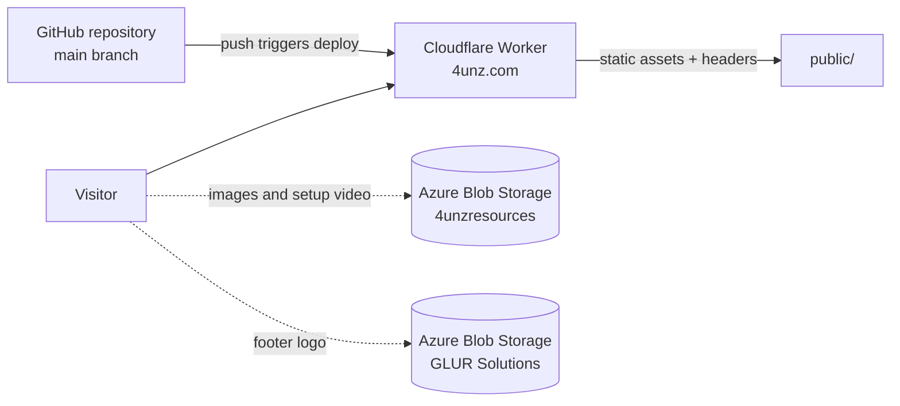

# 4unz-Website

The source for **[4unz.com](https://4unz.com)**, the website for **4u Ltd**, a New Zealand supplier of chainsaw sharpeners, ag tools, outdoor gear and hunting equipment, sold direct from the manufacturer: a fast, hand-written HTML/CSS/JS single page served as static assets by a Cloudflare Worker, with strict security headers and full search and social-sharing metadata.

There is no framework, no build step, no package manager and no server code. The `public/` folder is the site, and `wrangler.jsonc` is the only configuration file.

Built and maintained by [GLUR Solutions](https://glursolutions.com).

## What it does

- **One-page business site** with a sticky contact bar and header, a featured-product hero, a trust strip, three alternating product ranges, an About section (story, vision and mission), a contact section and a footer. See [Page structure](#page-structure).
- **Hero with a product image and a setup video.** One button swaps the product image for a video with a short cross-fade (and back again). The video is not downloaded until someone asks for it. See [Hero image and video](#hero-image-and-video).
- **Sticky header that slides down.** The contact bar and header scroll away with the page, then drop back in from the top once the visitor has scrolled past them.
- **Motion that replays and respects you.** Every section animates in each time it scrolls into view, and every animation is switched off for visitors who prefer reduced motion. See [Motion and interaction](#motion-and-interaction).
- **Search and sharing ready.** Canonical address, `robots` rules, a sitemap, Open Graph and Twitter card tags, and `schema.org` structured data. See [SEO and social sharing](#seo-and-social-sharing).
- **Tuned for speed.** Self-hosted fonts, preloaded hero image and fonts, an early connection to the image host, deferred JavaScript, reserved image sizes and lazy loading below the fold. See [Performance](#performance).
- **Locked-down security headers.** A Content Security Policy with no inline scripts or styles, HSTS, clickjacking protection and a feature lockdown, all set from one file. See [Security](#security).
- **Accessible and responsive.** Skip link, labelled landmarks, visible focus, `prefers-reduced-motion` handled in CSS and JS, and layouts that change at 1024px, 820px and 520px. Hover effects only run on devices that can really hover, so a tap on a phone never leaves one stuck on.
- **No forms, no cookies, no tracking.** Enquiries go through the email address and phone numbers on the page. The site loads no third-party scripts.

## How it fits together



| What | Served from | Notes |
| --- | --- | --- |
| HTML, CSS, JavaScript, fonts, icons, `robots.txt`, `sitemap.xml`, `og-image.jpg` | Cloudflare Worker static assets (`public/`) | Headers come from `public/_headers` |
| Product images, logos and the setup video | Azure Blob Storage container `4unzresources` | Loaded directly by the visitor's browser. All images are WebP |
| Footer GLUR Solutions logo | Azure Blob Storage container for GLUR Solutions | Same host as the other GLUR Solutions sites |

The Worker has no script of its own. `wrangler.jsonc` only points it at the `public/` folder, so Cloudflare serves the files and applies `_headers`. The repository is connected to the Worker, and every push to `main` deploys automatically. 4unz.com is attached to the Worker as its custom domain.

## Repository layout

```
public/                      The website (the only public folder)
  index.html                 The whole page: head metadata, icon sprite, all sections
  css/
    layout.css               Structure only: grid, spacing, responsive rules, sticky bar mechanics
    theme-final.css          Look and feel: colours, type, backgrounds, icons, chips, all motion styles
  js/
    main.js                  Hero swap, sticky bar, scroll-in animations, tilt, touch taps
  fonts/                     Self-hosted Barlow and Barlow Condensed (WOFF2)
  _headers                   Security headers and cache rules for the Worker
  robots.txt                 Crawl rules and sitemap address
  sitemap.xml                One-page sitemap
  favicon.ico                16px and 32px icon
  icon-192.png               Web app icon, also referenced by structured data
  icon-512.png               Large icon, used as the organisation logo in structured data
  apple-touch-icon.png       180px home-screen icon
  og-image.jpg               1200 x 630 social sharing image
wrangler.jsonc               Worker name, compatibility date and assets folder
README.md                    This file (kept in the repo root, so it is never published)
```

`layout.css` and `theme-final.css` are deliberately split. Layout decides where things sit and how they stack, and the theme decides how they look, so either can change without touching the other.

## Page structure

Each section carries a `data-label` attribute, an `aria-labelledby` heading and an anchor, so the navigation links and the **Enquire** links jump straight to it.

| Section | Anchor | Contents |
| --- | --- | --- |
| Contact bar and header | n/a | Email and phone links in a bar above the logo and main navigation. Sticky together |
| Hero | `#top` | "Chainsaw Sharpeners" featured product, **Enquire now** button and **Watch setup video** button |
| Trust strip | n/a | Three short claims: over 20 years trading, proudly NZ owned, direct from the manufacturer. A yellow hazard-stripe band |
| Ranges | `#products` | Three alternating rows: **Ag Products**, **The Farm, Outdoors & Camping** and **Hunting & Fishing**, each with an image, a feature list, optional spec chips and an Enquire link |
| About | `#about` | Our Story, Our Vision and Our Mission in three columns |
| Contact | `#contact` | Four cards: email, phone, mobile and postal address |
| Footer | n/a | 4u logo, "Proudly NZ Owned" badge, navigation and a credit to GLUR Solutions |

Skip link, `<main>`, the two `<nav>` landmarks (each labelled) and `<address>` for the postal address give assistive technology a clear map of the page.

## Front end

- **One page, three files.** `index.html` loads `layout.css`, then `theme-final.css`, then `main.js` with `defer`. There is nothing to compile, bundle or install.
- **Icon sprite.** The icons (clock, pin, arrow, mail, phone, mobile) live in one inline SVG sprite at the top of `<body>` and are used with `<use href="#i-...">`. This avoids extra requests and keeps the Content Security Policy free of `unsafe-inline`. All icons are `aria-hidden`, because each one sits next to visible text.
- **Design tokens.** Colours, fonts, the corner radius and the shared easing curve are CSS variables at the top of `theme-final.css`. Layout sizes (container width, gutter, section spacing, column gap) are variables at the top of `layout.css`.
- **Palette.** Navy (`#10264A`, `#0A1A2F`) for the header, hero, About band and footer, one yellow accent (`#F5B700`) for the trust strip, highlights and focus rings on dark areas, a blue (`#1D4ED8`) for focus rings on light areas, and soft grey-blue surfaces (`#F1F4F9`, `#E8EDF6`) for alternating bands and chips.
- **Type.** Barlow for text and Barlow Condensed for headings, both self-hosted (see [Fonts](#fonts)).
- **Backgrounds.** The blueprint grids and glows on the hero and About bands, and the stripes on the trust strip, are pure CSS gradients. There are no background images.
- **Images.** Every product image has explicit `width` and `height` so the page does not jump while loading, and every image below the fold uses `loading="lazy"`. All images carry descriptive `alt` text, except the logo inside a link that already has an `aria-label`.
- **Responsive.** Breakpoints at 1024px (narrower gutters, contact cards in two columns), 820px (everything stacks to one column, images move above text, the header logo centres above one row of navigation links that shrinks with the screen so it never wraps) and 520px (single-column contact cards, full-width buttons, a rebuilt three-row footer).
- **Anchor offset.** Because the header is fixed while scrolling, `scroll-padding-top` is set to the measured header height (`--site-top-height`, written by `main.js`) so a jump link never hides a heading behind it. A fallback value applies before the script runs.
- **Footer credit.** "Built with Love by GLUR" links to glursolutions.com with `rel="noopener noreferrer"`.

### Fonts

Five WOFF2 files are served from `public/fonts/`:

| File | Family | Weight |
| --- | --- | --- |
| `Barlow-Regular.woff2` | Barlow | 400 |
| `Barlow-Medium.woff2` | Barlow | 500 |
| `Barlow-SemiBold.woff2` | Barlow | 600 |
| `BarlowCondensed-SemiBold.woff2` | Barlow Condensed | 600 |
| `BarlowCondensed-Bold.woff2` | Barlow Condensed | 700 |

All use `font-display: swap`, so text shows immediately in a fallback font and swaps when the real font arrives. The two used above the fold (`Barlow-Regular` and `BarlowCondensed-Bold`) are preloaded. Fallback stacks are set for both families. Barlow is licensed under the SIL Open Font License 1.1.

### Hero image and video

The **Watch setup video** button swaps the product image for the video and back again.

- **Cross-fade.** Both items fade and shift for 400ms using the Web Animations API with the site's shared easing curve. The stage has a fixed shape in CSS, so nothing around it moves.
- **Locked while running.** Extra clicks are ignored during a transition, and the outgoing item is made `inert` until it finishes.
- **Accessible button.** The label switches between "Watch setup video" and "Hide setup video", and `aria-expanded` and `aria-controls` stay in step.
- **Lazy video.** The `<video>` uses `preload="none"` with the product image as its poster, so no video data downloads until the visitor presses play. Playback starts from the click, so browsers allow it.
- **Fallbacks.** Visitors who prefer reduced motion, or browsers without the Web Animations API, get an instant swap with no animation. Pausing happens when the video is hidden again.
- **Needs JavaScript.** The button does nothing without it, but the product image and every other part of the page still work.

## Motion and interaction

All of this lives in `js/main.js` (each block has a header comment) and in the motion section of `theme-final.css`. The page works with JavaScript off: elements are only hidden before they animate in while the script is running.

- **Scroll-in replay.** A pair of `IntersectionObserver`s plays each entrance when an element is 10% of the way up from the bottom of the screen, and resets it once not a single pixel is visible, so it plays again the next time the visitor scrolls back, from either direction.
- **Hero entrance.** The text rises line by line, the product slides in and its glow ignites. On screens 820px and narrower the product sits below the text, so it rises instead of sliding in from the side.
- **Product rows.** Each range plays a sequence: the image slides in from the side it sits on (or rises on small screens), then the heading, intro and bullet points fade up one after another, then the spec chips pop, then the **Enquire** link fades in and draws its underline. Timings are constants at the top of the block, and the two that must match the CSS are labelled.
- **Section intros.** "What we supply" and the Contact heading fade up line by line. The four contact cards continue the cascade after the heading, or play on their own when a phone stacks them below it.
- **About columns.** Each column draws a yellow bar, then drops its heading and paragraph from it. Side-by-side columns start 90ms apart. Stacked ones each play on their own.
- **Sticky header.** The contact bar and header scroll away with the page. Once the page has scrolled past their own height, they are fixed to the top and slide down over 800ms with a long, soft landing. They stay fixed until the page is back at the very top, where they rejoin the page flow with no visible jump. A shadow fades in while stuck. The measured height is written to `--site-top-height` and updates on resize. It works at every screen size.
- **Hero tilt.** The product image tilts in 3D towards the mouse while it is over the image (the tilt itself is CSS). On a touch screen, a tap tilts it towards the tap point for 700ms. Nothing happens while the video is showing.
- **Trust strip.** The yellow hazard stripes drift continuously in CSS, and are paused whenever the strip is off screen, so no animation runs where nobody can see it.
- **Hover and tap.** Buttons, chips, **Enquire** links, contact cards, the navigation and the footer links have hover and keyboard-focus effects. Hover effects live inside `@media (any-hover: hover)`. Because touch screens have no hover, a tap on a contact card or a hero button plays the hover effect (a `.tap` class) for 700ms instead.
- **Reduced motion.** For visitors with `prefers-reduced-motion: reduce`, the entrance, tilt and sticky-bar slide scripts do not start, all of these are skipped and the final state shows straight away. Smooth scrolling is turned off, the trust strip stays still, and hover effects keep their colour changes but lose their lift, tilt and movement.
- **Older browsers.** Without `IntersectionObserver` or the Web Animations API, everything stays visible and static.

## SEO and social sharing

All of it lives in the `<head>` of `index.html` and in the root files in `public/`.

- **Language and title.** `lang="en-NZ"`, a descriptive title and a meta description.
- **Indexing.** `index, follow` with `max-image-preview:large`, a canonical address of `https://4unz.com/`, `robots.txt` that allows everything and points to the sitemap, and a one-page `sitemap.xml`.
- **Social cards.** Open Graph tags (type, site name, locale `en_NZ`, address, title, description and a 1200 x 630 image with alt text) and `twitter:card` set to `summary_large_image`, so links preview well on Facebook, WhatsApp, LinkedIn and similar.
- **Structured data.** A JSON-LD `@graph` with an `Organization` (name, logo, image, description, email, telephone, PO Box address, New Zealand as the area served and two sales contact points) and a `WebSite` (language, publisher linked back to the organisation).
- **Keep it in sync.** The structured data repeats the contact details from the page, and search engines can penalise a mismatch. Whenever those details change on the page, change them in the JSON-LD too.
- **Icons and colour.** `favicon.ico`, a 192px and 512px PNG, an Apple touch icon and a `theme-color` of `#10264A` so mobile browser bars match the header.

## Performance

- **Fast first view.** The page opens a connection to the image host early (`preconnect`), preloads the hero image with `fetchpriority="high"` (it is the largest element on screen), and preloads the two fonts used above the fold.
- **Keep the preload in step.** The preload address must match the hero `` address. If the hero image URL changes (to another format, say), change it in both places. A comment in the file says so.
- **No blocking script.** `main.js` is loaded with `defer`, so it is fetched early but runs after the page is parsed.
- **Small and local.** No third-party scripts, no tracking pixels, no web font service, and no JavaScript framework. All five fonts, both stylesheets and the script come from the same host.
- **Reserved space.** Image `width` and `height` attributes and a fixed hero stage stop the page shifting as media loads.
- **Lazy loading.** Images below the fold load as they approach, and the setup video loads only on request.
- **Caching.** Fonts are cached for a year and marked `immutable`, since they never change in place. CSS and JavaScript are cached for a day. The `?v=` number on the three asset links is raised in each release, so browsers fetch fresh copies straight away.
- **Compression.** Cloudflare serves the text assets compressed, and every image is already WebP.

## Security

A static site has a small attack surface, and `public/_headers` locks down what is left. Cloudflare applies it to every response from the Worker.

| Header | Value and purpose |
| --- | --- |
| `Content-Security-Policy` | Everything defaults to the site's own origin. Scripts, styles, fonts and connections are `'self'` only, with no `unsafe-inline` and no `unsafe-eval`. Images may also come from the two Azure Blob hosts and `data:`, and media from the 4u Blob host only. `object-src 'none'`, `base-uri 'self'`, `form-action 'self'`, `frame-ancestors 'none'` and `upgrade-insecure-requests` |
| `Strict-Transport-Security` | `max-age=31536000`, so browsers use HTTPS for a year |
| `X-Content-Type-Options` | `nosniff`, so browsers never guess a file's type |
| `X-Frame-Options` | `DENY`, so the site cannot be put inside another page (clickjacking) |
| `Referrer-Policy` | `strict-origin-when-cross-origin` |
| `Permissions-Policy` | Accelerometer, camera, geolocation, gyroscope, microphone, payment and USB all switched off |
| `Cross-Origin-Opener-Policy` | `same-origin` |

The design choices that make this policy possible:

- **No inline code.** The icon sprite is inline SVG (which needs no policy exception), and all styles and scripts are separate files, so no `'unsafe-inline'` is needed.
- **No forms.** Visitors enquire by email or phone, so there is no form to forge, no spam filter to maintain and no personal data to store.
- **No cookies and no tracking.** Nothing is stored on the visitor's device.
- **Fixed external hosts.** The only outside addresses are the two Azure Blob hosts, and the Content Security Policy names them exactly. A new image or media host must be added to the policy in `_headers`, or the browser will block it.

## Running it locally

You need Node.js. Wrangler is run with `npx`, so there is no `package.json` and no install step.

```bash
git clone https://github.com/GLUR-DEV/4unz-Website.git
cd 4unz-Website
npx wrangler dev
```

Wrangler serves `public/` the same way the live Worker does, including the headers from `_headers`. The product images, logos and video load from Azure Blob Storage over the internet, so you need a connection to see them.

## Configuration

`wrangler.jsonc` is the only configuration file, and it holds no secrets.

| Name | Value | Purpose |
| --- | --- | --- |
| `name` | `4unz-website` | The Worker name. It must match the Worker in the Cloudflare dashboard |
| `compatibility_date` | `2026-11-22` | Pins the Workers runtime behaviour |
| `assets.directory` | `./public` | The folder served as the website |

There are no environment variables, bindings or secrets. The custom domain (4unz.com) is set in the Cloudflare dashboard, not in this repository.

## Deploying

The repository is connected to a Cloudflare Worker, and **every push to `main` deploys automatically**. There is no build command, because the Worker serves `public/` as it is.

After a deploy:

- Reloading picks up the new CSS and JavaScript straight away, because the asset links carry a version number (`?v=`). If you change either file, raise the number on the matching link in `index.html`.
- Header changes in `_headers` and everything else in `public/` take effect with the same deploy.

## Updating the site

- **Text and layout.** Edit `public/index.html`. Product ranges are three `<article class="range">` blocks. Each has an image, a heading, a feature list, optional `chips` and an **Enquire** link.
- **Images and video.** Upload WebP files to the `4unzresources` container and point the `` at the new address, keeping the `width`, `height` and `alt` attributes correct. If the hero image changes, update its preload and the video `poster` too.
- **Contact details.** Change them in the contact bar, the Contact section and the JSON-LD block together.
- **Sitemap.** Update `<lastmod>` in `sitemap.xml` when the page changes in a way that matters to search.
- **New outside host.** Add it to the Content Security Policy in `_headers` first.
- **Colours and type.** Change the variables at the top of `theme-final.css`.
- **Animation timing.** Change the constants at the top of the scroll-in block in `main.js`. Two of them (`TEXT_DURATION` and `CHIP_STEP`) must match the transition and `.pop` lengths in `theme-final.css`.

## Versions

Each release is a commit whose message starts with the version (for example `v1.10.2: ...`), and releases are also marked with Git tags. The project started with four-part numbers (such as `v1.0.10.1`) and later moved to three-part numbers, so a few older commits and tags use the earlier style.

## Licence

Copyright © GLUR Solutions. All rights reserved, except as follows.

This source code was written for **4u Ltd** and is licensed for commercial use only between GLUR Solutions and 4u Ltd.

**You may**, for personal use:

- clone this repository;
- read, modify and run the code on your own machine.

**You may not**, without explicit written consent from GLUR Solutions or 4u Ltd:

- publish, host or deploy this site or any copy or derivative of it;
- redistribute the source code, in whole or in part;
- use it commercially.

To ask for permission, get in touch via [glursolutions.com](https://glursolutions.com).

The Barlow and Barlow Condensed font files are used under the [SIL Open Font License 1.1](https://openfontlicense.org) and keep their own licence.
